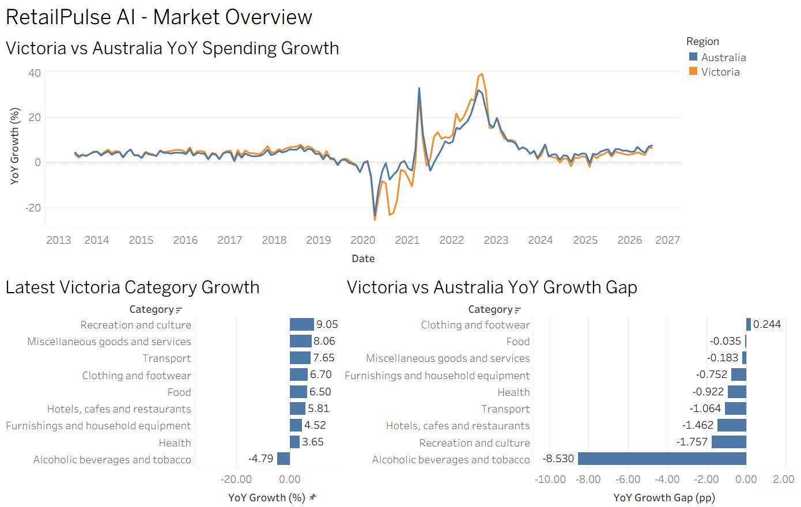
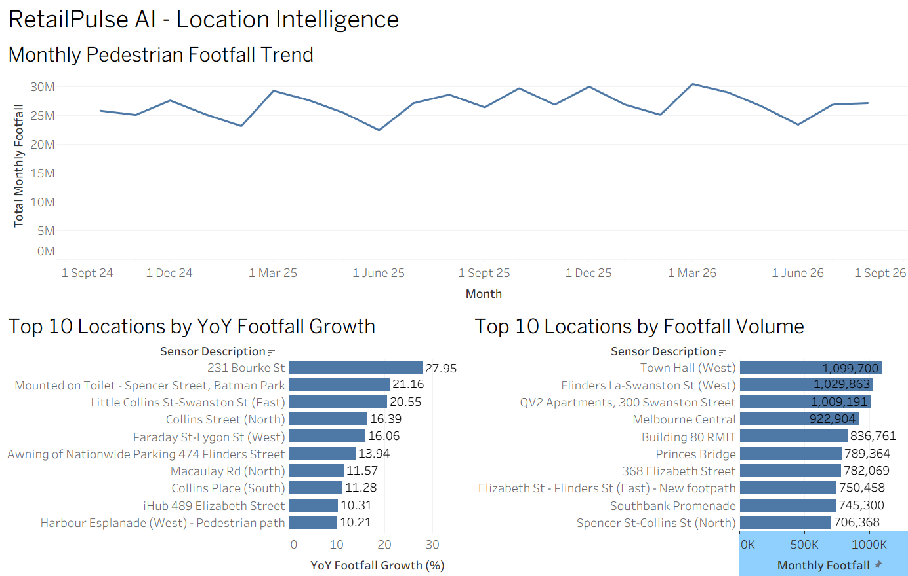
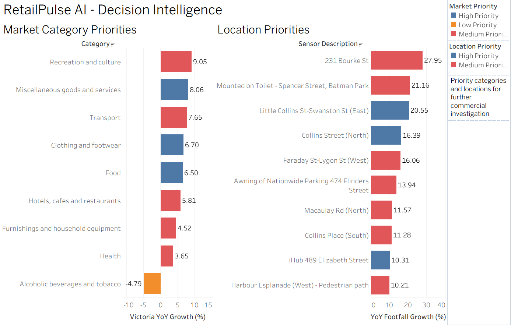

# RetailPulse AI

RetailPulse AI is an end-to-end retail decision-intelligence project combining Australian household spending data with Melbourne pedestrian activity to identify market signals and priority locations for further commercial investigation.

## Executive Summary

- **Clothing and footwear, Food, and Miscellaneous goods and services** were identified as the strongest **High Priority market categories** in the latest reporting period.
- **Little Collins St-Swanston St (East)** was one of the strongest High Priority location signals, combining approximately **643,499 monthly pedestrian movements** with **20.55% validated YoY growth**.
- **Recreation and culture** recorded the fastest Victorian category growth at approximately **9.05% YoY**, but remained **Medium Priority** because Victoria underperformed Australia by approximately **1.76 percentage points**.
- The outputs are intended to identify areas that **warrant further commercial investigation**, rather than make direct store-opening or investment recommendations.

The project covers:

- Australian Bureau of Statistics household spending analysis
- Melbourne pedestrian activity analysis
- Market and location KPI development
- Decision-priority scoring
- Tableau-ready datasets and dashboards
- AI-assisted management reporting with validation guardrails

## Contents

- [Executive Summary](#executive-summary)
- [Interactive Dashboards](#interactive-dashboards)
- [Dashboard Preview](#dashboard-preview)
- [Business Question](#business-question)
- [Data Sources](#data-sources)
- [Analytical Boundary](#analytical-boundary)
- [Project Workflow](#project-workflow)
- [Key Features](#key-features)
- [Repository Structure](#repository-structure)
- [Project Outputs](#project-outputs)
- [Tech Stack](#tech-stack)
- [Key Findings](#key-findings)
- [Limitations](#limitations)
- [How to Run the Project](#how-to-run-the-project)
- [AI-Assisted Reporting & Validation](#ai-assisted-reporting--validation)
- [Future Improvements](#future-improvements)

## Interactive Dashboards

Explore the RetailPulse AI dashboards on Tableau Public:

[View RetailPulse AI - Retail Decision Intelligence](https://public.tableau.com/app/profile/devika.jayaraj/viz/RetailPulseAI-RetailDecisionIntelligence/Dashboard1)

The published workbook includes navigation between:

- Market Overview
- Location Intelligence
- Decision Intelligence

## Dashboard Preview

### Market Overview



### Location Intelligence



### Decision Intelligence



## Business Question

How can a retail strategy team combine Australian consumer-spending trends with Melbourne pedestrian activity to identify emerging demand patterns, prioritise categories and locations for further investigation, and automate part of the recurring market-review process using AI?

## Data Sources

This project uses publicly available Australian government and City of Melbourne datasets.

### Australian Bureau of Statistics

- [Monthly Household Spending Indicator — July 2026](https://www.abs.gov.au/statistics/economy/finance/monthly-household-spending-indicator/jul-2026#data-downloads) — Australian Bureau of Statistics

Source credit: **Australian Bureau of Statistics (ABS), Monthly Household Spending Indicator.**

### City of Melbourne

- [Pedestrian Counting System — Counts per Hour](https://data.melbourne.vic.gov.au/explore/dataset/pedestrian-counting-system-monthly-counts-per-hour/export/) — City of Melbourne Open Data
- [Pedestrian Counting System — Sensor Locations](https://data.melbourne.vic.gov.au/explore/dataset/pedestrian-counting-system-sensor-locations/export/) — City of Melbourne Open Data

Source credit: **City of Melbourne Open Data, Pedestrian Counting System.**

> Note: The raw hourly pedestrian counts file is approximately 120 MB and is not stored in this GitHub repository. The processed datasets used in the analysis are included in `data/processed/`.

## Analytical Boundary

Spending and pedestrian datasets are analysed separately and combined only at the decision-support stage.

The analysis does not claim that spending changes cause pedestrian changes, or that pedestrian activity directly represents store sales.

## Project Workflow

The project follows an end-to-end analytics workflow:

1. Raw data collection
2. Data quality audit
3. Data transformation
4. KPI analysis
5. Market and location signal generation
6. Decision-priority scoring
7. Tableau-ready dataset creation
8. AI-assisted management reporting
9. Automated validation of reporting outputs

### Analytical Flow

Raw Data → Quality Audit → Transformation → KPI Analysis → Signal Generation → Decision Priorities → Tableau-ready Outputs → AI Reporting & Validation

## Key Features

- Automated cleaning and transformation of ABS household spending data
- Validation of monthly time-series continuity and missing values
- Comparison of Victoria household spending growth against Australia
- Exact calendar-month matching for pedestrian month-on-month and year-on-year analysis
- Sensor coverage validation to reduce misleading pedestrian growth calculations
- Market and location signal generation using defined business rules
- Priority scoring for further commercial investigation
- Tableau-ready analytical outputs
- AI-assisted management reporting with validation guardrails
- Automated checks to validate report structure, prohibited recommendation language and numeric values directly against validated analytical tables
- Guardrail stress test using a deliberately unsafe store-opening recommendation to confirm that unsupported recommendations are detected

## Repository Structure

```text
retailpulse-ai/
├── data/
│   ├── raw/
│   │   ├── ABS Monthly Household Spending Indicator/
│   │   └── City of Melbourne Pedestrian Counting System/
│   └── processed/
├── notebooks/
│   └── retailpulse_ai_analysis.ipynb
├── reports/
│   ├── ai_management_summary.txt
│   ├── ai_validation_results.csv
│   └── ai_guardrail_test_results.csv
├── tableau/
│   ├── market_overview.png
│   ├── location_intelligence.png
│   └── decision_intelligence.png
├── .gitignore
├── README.md
└── requirements.txt
```

## Project Outputs

The project produces the following decision-support outputs:

- `data/processed/abs_spending_long.csv` — transformed ABS spending data in long format
- `data/processed/pedestrian_monthly_location.csv` — monthly pedestrian activity by location
- `data/processed/spending_kpis.csv` — spending growth and trend metrics
- `data/processed/spending_comparison.csv` — Victoria vs Australia category comparison
- `data/processed/latest_market_priorities.csv` — latest market signals and investigation priorities
- `data/processed/pedestrian_kpis.csv` — location-level pedestrian KPIs
- `data/processed/latest_location_priorities.csv` — latest validated location signals and priorities
- `reports/ai_management_summary.txt` — AI-assisted management summary
- `reports/ai_validation_results.csv` — wording and numerical validation results for the current management summary
- `reports/ai_guardrail_test_results.csv` — deliberate unsafe-summary guardrail test results

The outputs are designed to support further commercial investigation rather than direct store-opening or investment decisions.

## Tech Stack

- Python
- Pandas
- NumPy
- Jupyter Notebook
- Tableau
- OpenAI API
- CSV / Excel data processing
- GitHub

## Key Findings

### Market Signals

- Victoria showed strong year-on-year growth across several household spending categories in the latest reporting period.
- **Miscellaneous goods and services, Clothing and footwear, and Food** were classified as High Priority market categories.
- **Recreation and culture** recorded the strongest Victorian YoY growth at approximately **9.05%**, but remained Medium Priority because Victoria was approximately **1.76 percentage points below Australia** on the same YoY comparison.
- Strong growth alone was therefore not treated as sufficient evidence; Victoria's performance relative to Australia was also used as part of the priority logic.

### Location Signals

- Several Melbourne pedestrian locations showed strong validated year-on-year growth while also maintaining meaningful footfall volumes.
- **Little Collins St-Swanston St (East)** recorded approximately **643,499 monthly pedestrian movements** and **20.55% validated YoY growth**, making it one of the strongest High Priority location signals.
- **Collins Street (North)** and **iHub 489 Elizabeth Street** were also classified as High Priority location signals.
- Locations were prioritised using both growth and activity scale rather than ranking solely by percentage growth.
- Sensor coverage validation was applied before year-on-year comparisons to reduce the risk of misleading signals caused by incomplete observations.

### Decision Intelligence

Market and location evidence are treated as independent signals and brought together only at the decision-support stage.

The outputs identify where further commercial investigation may be warranted rather than making direct store-opening or investment recommendations.

## Limitations

- Household spending and pedestrian activity are separate datasets with different geographic and time structures.
- The analysis does not assume that changes in pedestrian activity cause changes in spending, or vice versa.
- Pedestrian counts represent activity around sensor locations and should not be interpreted as store-level sales, customer conversion or profitability.
- Some pedestrian sensors have incomplete historical coverage, so year-on-year comparisons are only used when both the current and prior-year periods meet the defined coverage threshold.
- Priority labels are analytical decision-support signals designed to identify areas that warrant further commercial investigation.
- External factors such as demographics, competition, rent, store economics and local trading conditions would need to be incorporated before making a real investment decision.

## How to Run the Project

1. Clone or download this repository.
2. Open `notebooks/retailpulse_ai_analysis.ipynb`.
3. Install the required libraries using:

```bash
pip install -r requirements.txt
```

4. Place the required raw data files in the corresponding folders under `data/raw/`.
5. Run the notebook from top to bottom.
6. Generated analytical outputs will be saved under `data/processed/` and `reports/`.

### Required External Raw File

The City of Melbourne hourly pedestrian counts file is not stored in this repository because it is approximately 120 MB.

Download:

`pedestrian-counting-system-monthly-counts-per-hour.csv`

and place it in:

```text
data/raw/City of Melbourne Pedestrian Counting System/
```

## AI-Assisted Reporting & Validation

The project includes an AI-assisted reporting layer that converts validated analytical outputs into a concise management summary.

The AI component is intentionally used as a reporting layer rather than as the source of calculations or KPI logic.

Key controls include:

- Only validated market and location outputs are provided to the reporting layer
- The prompt explicitly prevents invented calculations and causal claims
- Market and pedestrian evidence are treated as independent evidence streams
- Direct store-opening recommendations are prohibited
- Selected numeric values are checked directly against validated analytical tables
- Wording guardrails detect unsupported store-opening recommendation language
- A deliberately unsafe summary is used to confirm that the guardrail can fail as expected
- The summary source is recorded so it is clear whether the output came from the OpenAI API or the fallback workflow
- A fallback management summary is used when the API is unavailable

This approach demonstrates how generative AI can support analytics communication while keeping the underlying calculations deterministic and auditable.

## Future Improvements

Potential extensions include:

- Adding demographic and socioeconomic data to strengthen location analysis
- Incorporating competitor locations and proximity measures
- Adding rental or commercial property data for deeper site evaluation
- Automating scheduled data refreshes and reporting
- Expanding the AI reporting layer into a repeatable stakeholder briefing workflow
- Deploying the analytical pipeline using cloud-based data and automation tools

## Author

**Devika Jayaraj**  
Master of Data Science, RMIT University  
Melbourne, Australia

Interested in Data Analytics, Business Intelligence, Data Engineering and AI-enabled analytics.

Connect with me on LinkedIn: [linkedin.com/in/devika-jayaraj](https://www.linkedin.com/in/devika-jayaraj)
```

This is the version I’d use now.
